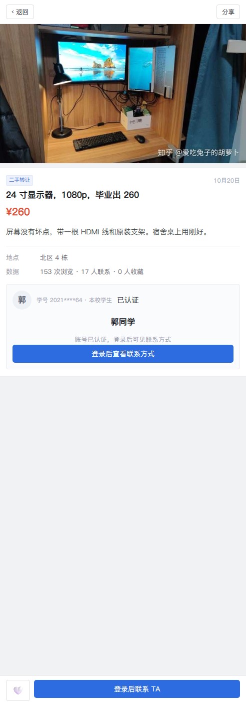
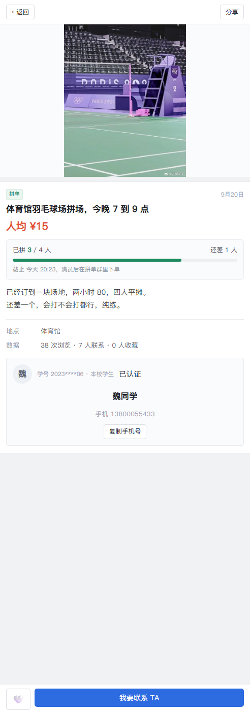
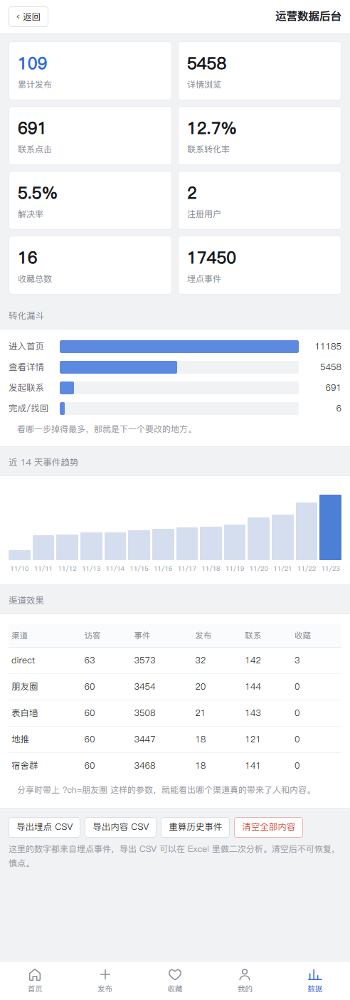

# 校园信息墙 · 失物招领 · 二手转让 · 拼单

**在线预览：<https://46bzvs7m64-gif.github.io/campus-info-wall/>**

一个给高校用的信息墙 H5：丢东西、卖二手、拼单，发一条 30 秒，找东西不用再翻几十个微信群。
纯前端单文件实现，**零依赖、零构建、双击即开**，同时内置了运营需要的一整套埋点与数据看板。


## 30 秒看完（给面试官）

1. 顶部四个板块切一下，点任意卡片进详情 —— 列表是 64px 方图，一屏能扫 7 条；
2. 看「拼单」那条，详情页有**已拼 3/4 人**的进度条（这版新加的内容类型）；
3. 联系方式的默认对陌生人不显示，只露出**发布者账号（昵称 + 打码学号 + 已认证）**，登录后才看得到手机号；
4. 用 `admin` / `admin123` 登录，底部会多出「数据」——8 个指标、四步漏斗、14 天趋势、渠道效果表；
5. 分享链接带 `?ch=宿舍群`，后台能看出不同渠道分别带来了多少人和多少内容。

## 它解决什么问题

校园里的信息分散在几十个班级群、宿舍群里：丢了东西没人看见，卖东西三天就被刷走，
而且**没人知道到底有多少人被看见、多少人真的联系上了**。

这个项目把两件事放在一起做：

1. 给同学一个能发、能搜、能联系的地方；
2. 给运营一个能看懂"哪一步掉了人"的后台 —— 每一屏都埋了点，用数据决定下一版改什么。

## 功能

**同学侧**

- 注册要填学号（8–12 位，只显示在自己页面，不出现在发布内容里），登录支持昵称或学号
- 首页：失物招领 / 二手转让 / 拼单三个板块，支持搜索与筛选，列表带真实照片
- 拼单：填"还要拼几人"和"截止几点"，详情页显示进度条（已拼 3/4、还差 1 人），列表显示人均价
- 发布：标题、详情、价格、地点、联系方式，最多 2 张图（canvas 自动压到 640px）
- 详情：收藏（再点一次取消，账号级，不重复累加）；联系方式默认隐藏，只显示发布者账号（昵称 + 打码学号 + 已认证），**登录后**才看得到手机号并一键复制，未登录点「联系」会先跳登录
- 我的收藏 / 我的发布：可以标记已解决、重新打开、删除（删除会级联清理所有人的收藏）

**运营侧（管理员登录后出现「数据」入口）**

- 8 个核心指标：累计发布、详情浏览、联系点击、联系转化率、解决率、注册用户、收藏总数、埋点事件数
- 四步转化漏斗：进入首页 → 查看详情 → 发起联系 → 完成/找回
- 近 14 天事件趋势 + 渠道效果表（访客 / 事件 / 发布 / 联系 / 收藏）
- 导出埋点 CSV、导出内容 CSV、重算历史事件、清空全部内容

| 详情页 | 拼单 | 我的发布 | 数据后台 |
|---|---|---|---|
|  |  |  |  |

## 怎么跑起来

不需要安装任何东西：

```bash
# 方式一：直接双击 index.html
# 方式二：起个静态服务（推荐，便于手机同局域网访问）
python -m http.server 8099
# 然后打开 http://127.0.0.1:8099/
```

管理员账号：`admin` / `admin123`（学号 2020010101）。登录后底部会多一个「数据」入口。

## 实现说明

| 部分 | 做法 | 为什么这么选 |
|---|---|---|
| 存储 | `localStorage`，键前缀 `ciw4_`，封装成 `DB.get / DB.set` 两个方法 | 换成后端只改这两个函数，上层页面不用动 |
| 密码 | `hash()`（djb2 变体 + 长度后缀） | **不是安全方案**，只用于演示流程，注释里写清楚了 |
| 路由 | hash 路由（`#/item/:id` 等） | 静态托管不用配置 rewrite，任何地方都能直接打开 |
| 埋点 | 事件对象 `{t, ev, id, uid, ch}`，上限 20000 条 | 一张表能同时算漏斗、趋势、渠道归因 |
| 渠道追踪 | 分享链接带 `?ch=宿舍群` | 分清哪条渠道真的带来了人和内容，避免"感觉有效" |
| 拼单 | 内容对象多三个字段 `need / joined / until`，列表和详情各渲染一处 | 不新开一张表，复用同一套列表、搜索、收藏、后台统计 |
| 视觉 | 无框架手写 CSS，单一主色 + 1px 分隔线 + 6px 圆角，零阴影零渐变 | 工具类产品不该长得像海报；列表用 64px 方图，一屏能扫 7 条 |

历史数据是**按内容反算的种子事件**（`injectBaseline()`），用来让看板在演示时不是空的，
不是真人流量 —— 真实跑起来后点「清空全部内容」再重新积累即可。

## 已知局限

- 数据存在每个访问者自己的浏览器里，**换设备不同步、你也看不到别人的数据**；
  真要做运营，下一步是接一个轻量后端 + 埋点上报。
- 密码只是演示用的弱哈希，不要用它存真实密码。
- `img/` 里的照片是网上公开的**用户实拍图**（知乎 / 贴吧 / 小红书等来源），
  仅用于本地演示，**正式上线请换成自己拍的或已授权的图**。

## 目录结构

```
index.html        单文件应用（HTML + CSS + JS 全在里面）
img/              108 张示例照片，按内容命名
img/t/            同名的 200px 缩略图（列表用，单张约 6KB；点进详情才加载原图）
docs/             截图
```

## License

[MIT](LICENSE)
